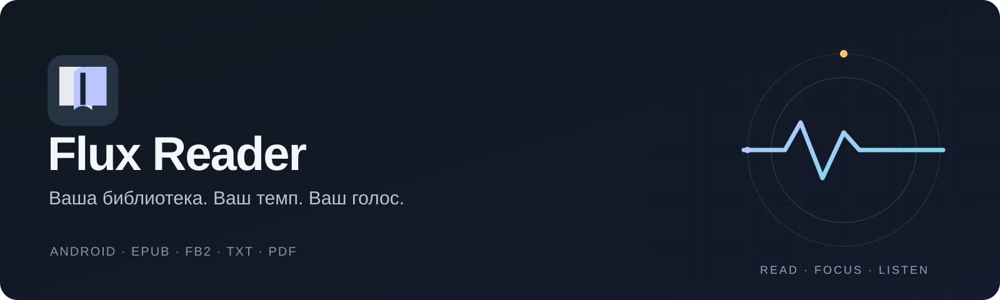
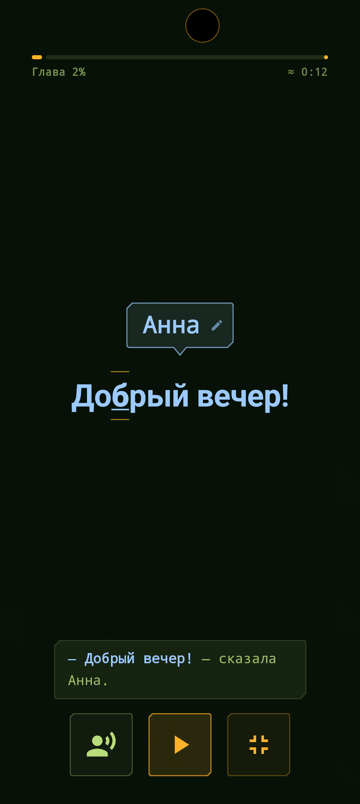
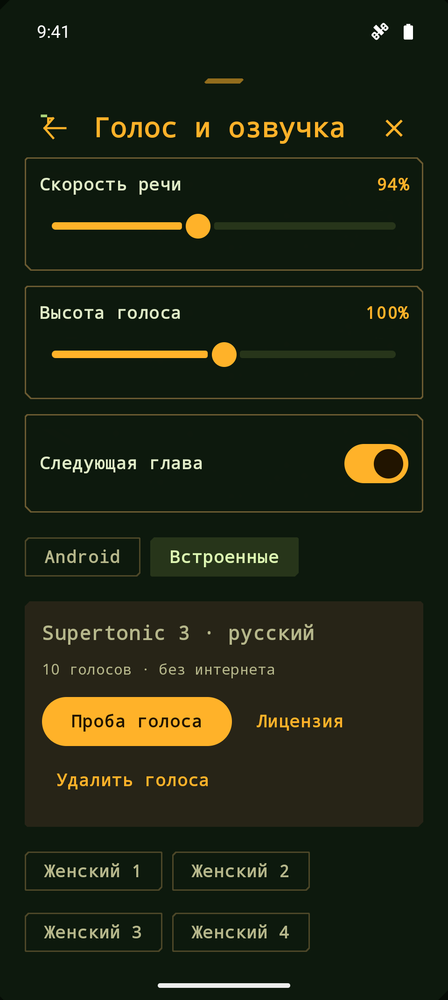
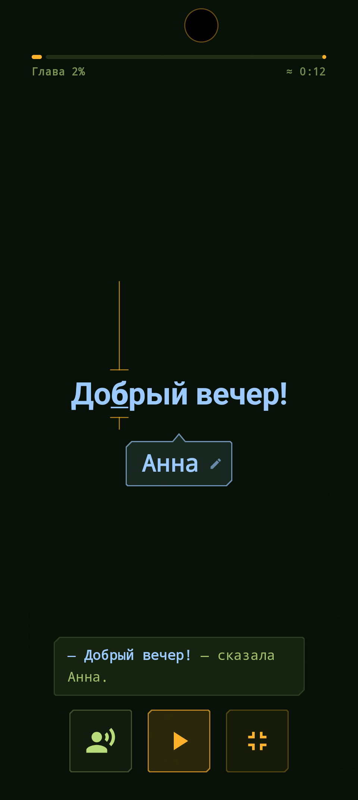
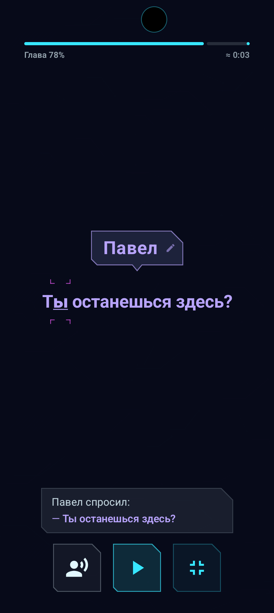
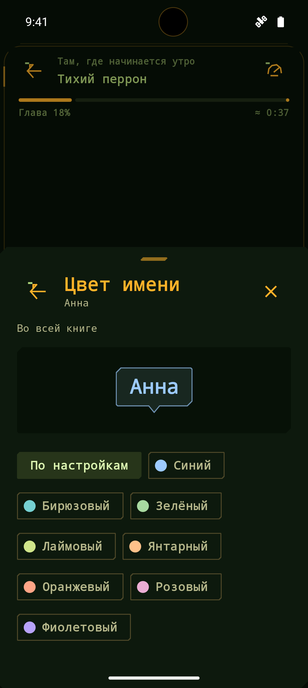

  

  <strong>Ваша библиотека. Ваш темп. Ваш голос.</strong> 
  Читалка для Android с обычным чтением, скорочтением и встроенной озвучкой.

  <a href="https://github.com/nrevis/FluxReader/releases/download/v0.2.0-alpha.106/FluxReader-0.2.0-alpha.106-release.apk"><strong>Скачать APK</strong></a> ·
  <a href="https://github.com/nrevis/FluxReader/releases/tag/v0.2.0-alpha.106">Что нового</a> ·
  <a href="https://github.com/nrevis/FluxReader/releases/download/v0.2.0-alpha.106/FluxReader-0.2.0-alpha.106-clean.zip">Исходники</a> ·
  <a href="docs/USER-GUIDE.md">Руководство</a>

Android 9+ · alpha.106 · Автор: n.revis

## Три способа читать

<table>
<tr>
<td width="33%" align="center"> <strong>Читайте</strong> Страницы, прокрутка, шрифты и заметки</td>
<td width="33%" align="center"> <strong>Ускоряйтесь</strong> RSVP, фразы и свой темп показа</td>
<td width="33%" align="center"> <strong>Слушайте</strong> Встроенные голоса без системного TTS</td>
</tr>
</table>

## Всё для своей библиотеки

| Возможность | Что внутри |
| --- | --- |
| **Книги и документы** | EPUB, FB2, FB2.ZIP, TXT и PDF; импорт файлов, архивов и каталогов |
| **Порядок в библиотеке** | Папки, серии, авторы, поиск, обложки и сохранение прогресса |
| **Текст под себя** | Шрифты, поля, межстрочный интервал, темы, закладки и заметки |
| **Скорочтение** | RSVP по словам, фразы, три направляющие, WPM и паузы |
| **Диалоги** | Экспериментальные подписи говорящих, свои цвета имён и реплик, ручная коррекция |
| **Звук** | Скачиваемые голоса Supertonic 3, Android TTS и локальные аудиокниги |

## Интерфейс под настроение

Нейтральная тема для спокойного чтения, **Wasteland** с янтарными акцентами и **Cyberpunk** с неоновым оформлением. Цвета персонажей настраиваются отдельно.

<table>
<tr>
<td width="33%" align="center"> Wasteland</td>
<td width="33%" align="center"> Cyberpunk</td>
<td width="33%" align="center"> Цвета персонажей</td>
</tr>
</table>

## Установка

1. Скачайте **[APK alpha.106](https://github.com/nrevis/FluxReader/releases/download/v0.2.0-alpha.106/FluxReader-0.2.0-alpha.106-release.apk)** и разрешите установку из выбранного источника в Android.
2. Добавьте книгу через **«Добавить»** в библиотеке.
3. Для встроенной озвучки откройте **«Голос и озвучка → Встроенные → Скачать голоса»**.

Пакет озвучки содержит **10 голосов**, загружается отдельно — около **123 МБ**. После установки он работает без сети и синтезатора Android. APK — около 229 МБ. Для получения новых alpha-версий включите тестовые релизы в **«Настройки → О программе → Обновления»**.

<strong>Что важно знать об alpha-версии</strong>

- Анализ диалогов экспериментальный: возможны ошибки и реплики без подписи. Это локальные правила, без LLM.
- Встроенная озвучка показывает текущую фразу; точных временных границ каждого слова у модели нет. Ударения и имена могут произноситься неточно.
- Пакет голосов распространяется по OpenRAIL-M; лицензия доступна перед загрузкой. Источник модели архивирован, используется закреплённая версия через sherpa-onnx.
- OCR зависит от включённых языковых моделей. В обычном APK доступен резервный ML Kit Latin; русские модели Tesseract добавляются при отдельной сборке.
- Сетевые голоса Android могут передавать текст своему сервису. Встроенная озвучка обрабатывает текст на устройстве.

## Подробнее

[Руководство](docs/USER-GUIDE.md) · [Диалоги и цвета](docs/BOOK-DIALOGUE-ANALYSIS.md) · [Встроенные голоса](docs/OFFLINE-SPEECH.md) · [Все скриншоты](docs/SCREENSHOTS.md) · [Сборка из исходников](DEVELOPMENT.md) · [Все выпуски](https://github.com/nrevis/FluxReader/releases)

Нашли проблему? **[Создайте issue](https://github.com/nrevis/FluxReader/issues/new)**: укажите версию приложения, модель телефона и шаги воспроизведения. [Как помочь проекту](.github/CONTRIBUTING.md).
