

# Flux Reader

**Книги, скорочтение и голос — в одном приложении для Android.**

EPUB · FB2 · FB2.ZIP · TXT · PDF · Аудиокниги

[**Скачать APK**](https://github.com/nrevis/FluxReader/releases/tag/v0.2.0-alpha.95) · [Исходники](https://github.com/nrevis/FluxReader) · [Все скриншоты](#gallery)

**Android 9+** · **0.2.0-alpha.95** · **Автор: n.revis**

---

Flux Reader объединяет домашнюю библиотеку, обычное чтение, показ текста в заданном темпе и озвучку. Можно читать страницу за страницей, следить за словами в Speed Reader или слушать книгу установленным голосом Android. Книги, позиции чтения и заметки хранятся на устройстве; чтение работает без интернета.

<table>
<tr>
<td align="center" valign="top"><a href="docs/screenshots/library/books-list.jpg">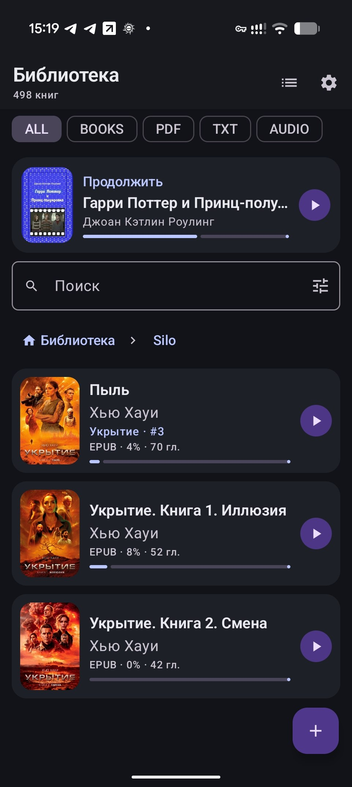</a> Библиотека</td><td align="center" valign="top"><a href="docs/screenshots/reading/wasteland-immersive.jpg">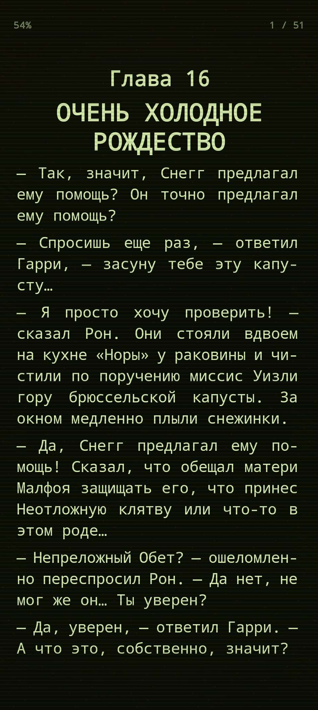</a> Чтение · Wasteland</td><td align="center" valign="top"><a href="docs/screenshots/speed-reading/immersive-playback.jpg">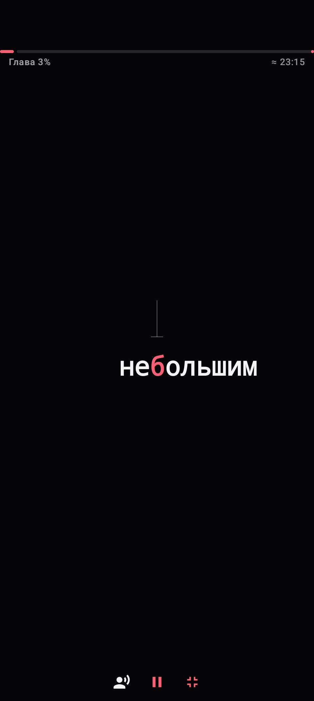</a> Speed Reader</td>
</tr>
</table>

## Возможности с первого взгляда

| Библиотека | Чтение | Скорочтение | Звук и документы |
| --- | --- | --- | --- |
| Папки, группы, серии, авторы | Прокрутка и страницы | RSVP, фразы и фокус | Офлайн-озвучка Android TTS |
| Сетка, компактно и список | Полный экран и жесты | Настраиваемые WPM и паузы | Локальные аудиокниги |
| Поиск, фильтры, сортировка | Шрифты, поля и палитры | Контекст и точка фиксации | PDF и распознавание сканов |
| Импорт файлов, ZIP и каталогов | Закладки, цитаты и заметки | Сохранение позиции | Проверка обновлений через GitHub |

## Навигация

[Библиотека](#library) · [Импорт и организация](#import) · [Чтение](#reading) · [Настройка текста](#typography) · [Заметки](#notes) · [Скорочтение](#speed) · [Голос и аудиокниги](#audio) · [Оформление](#appearance) · [PDF и OCR](#pdf) · [Установка и обновления](#updates)

## 01 · Библиотека

Библиотеку можно показать крупными обложками, компактной сеткой или списком с автором, серией и прогрессом. Карточка **«Продолжить»** возвращает к последней книге, а путь над списком помогает перемещаться между папками.

- Фильтры **ALL / BOOKS / PDF / TXT / AUDIO** отделяют нужный тип содержимого.
- Поиск по библиотеке и сортировка по недавнему чтению, названию, автору, серии, дате добавления или прогрессу.
- Группировка по папкам, пользовательским группам, сериям и авторам; доступен и общий список без группировки.
- Папки с подпапками. Одна книга может находиться в нескольких папках без дублирования файла.
- Последняя открытая папка сохраняется при переходах между библиотекой, настройками и чтением, а также после перезапуска.
- Встроенные обложки EPUB/FB2, первая страница PDF или локально созданная обложка, если изображения нет. Обложки можно обновить.

<table>
<tr>
<td align="center" valign="top"><a href="docs/screenshots/library/folders-compact.jpg">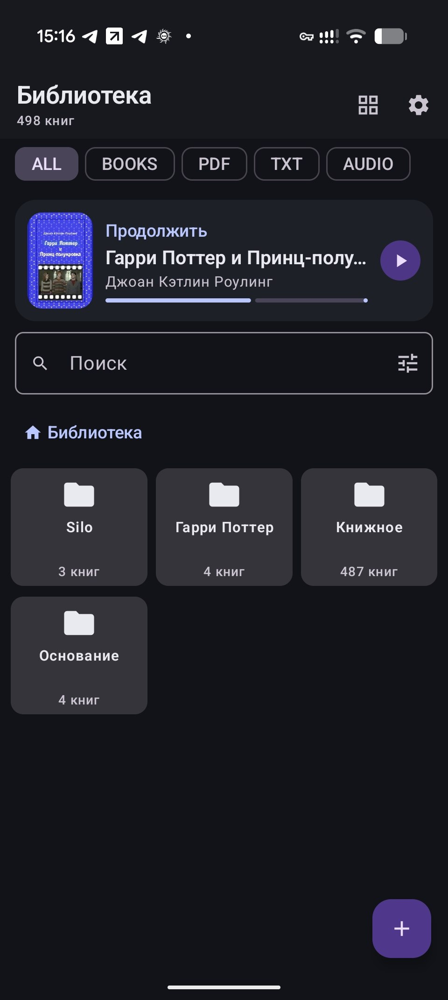</a> Папки библиотеки: компактная сетка</td><td align="center" valign="top"><a href="docs/screenshots/library/folders-list.jpg">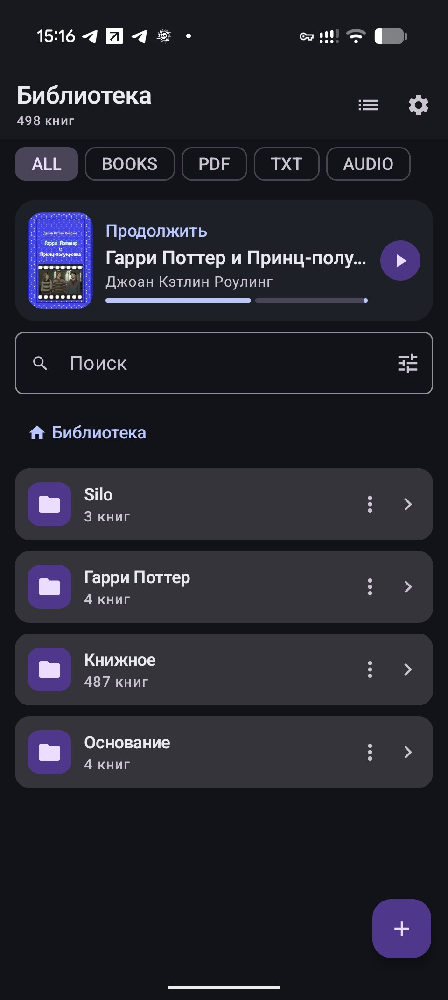</a> Папки библиотеки: список</td>
</tr>
</table>

<strong>Сравнить виды книг и открыть настройки библиотеки</strong>

<table>
<tr>
<td align="center" valign="top"><a href="docs/screenshots/library/folders-grid.jpg">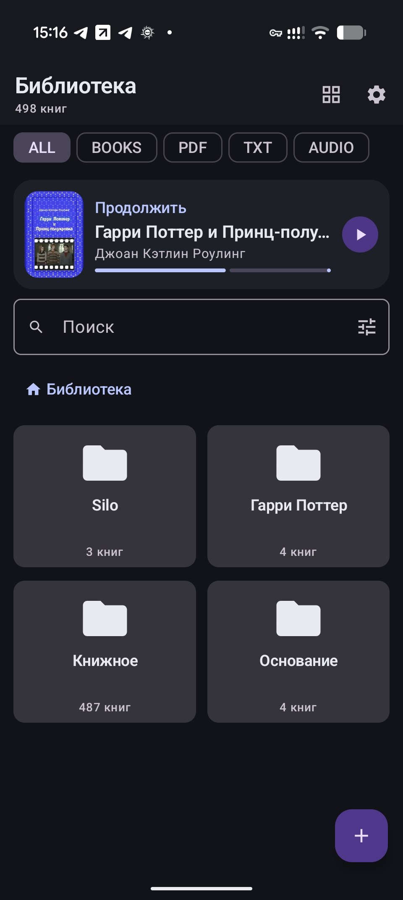</a> Папки библиотеки: крупная сетка</td><td align="center" valign="top"><a href="docs/screenshots/library/books-compact.jpg">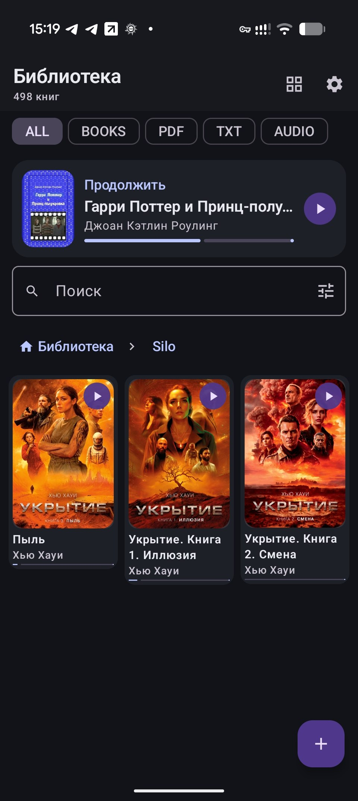</a> Книги: компактная сетка</td>
</tr>
</table>
<table>
<tr>
<td align="center" valign="top"><a href="docs/screenshots/library/library-preferences.jpg">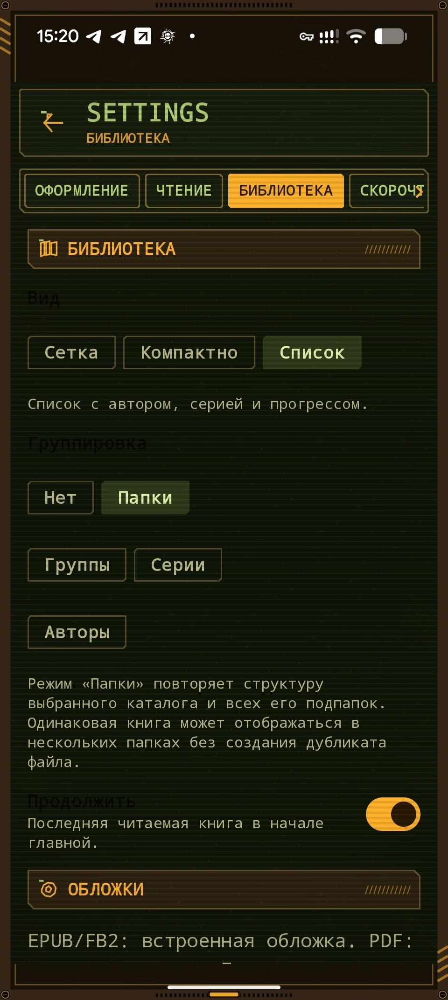</a> Настройки вида, группировки и обложек</td>
</tr>
</table>

## 02 · Импорт и организация

Нажмите **«+»** в библиотеке, чтобы добавить книги, ZIP-архив, аудиофайлы или каталог вместе с подпапками. Здесь же создаётся новая папка.

| Что добавить | Поддержка |
| --- | --- |
| Электронные книги | EPUB, FB2, FB2.ZIP, TXT |
| Документы | PDF |
| ZIP-архив | Пакетный импорт поддерживаемых книг |
| Каталог | Импорт с подпапками и сохранением структуры |
| Аудиокниги | MP3, M4A, M4B, AAC, OGG/OGA, FLAC, WAV, OPUS, 3GP; воспроизведение зависит от кодеков Android |

При большом импорте показывается ход обработки; операцию можно отменить. Повторный импорт существующей книги может связать её с другой папкой вместо создания копии.

Для выбранных книг доступны добавление и перемещение в папку, создание папки из выделенного набора и удаление. **«Выделить все видимые»** помогает обработать текущую выборку сразу.

В редакторе метаданных можно изменить название, автора, серию и номер в ней, группы, издательство, год, язык и описание. Для книги доступны также действия с обложкой, копирование и перемещение через её меню.

<table>
<tr>
<td align="center" valign="top"><a href="docs/screenshots/library/import-menu.jpg">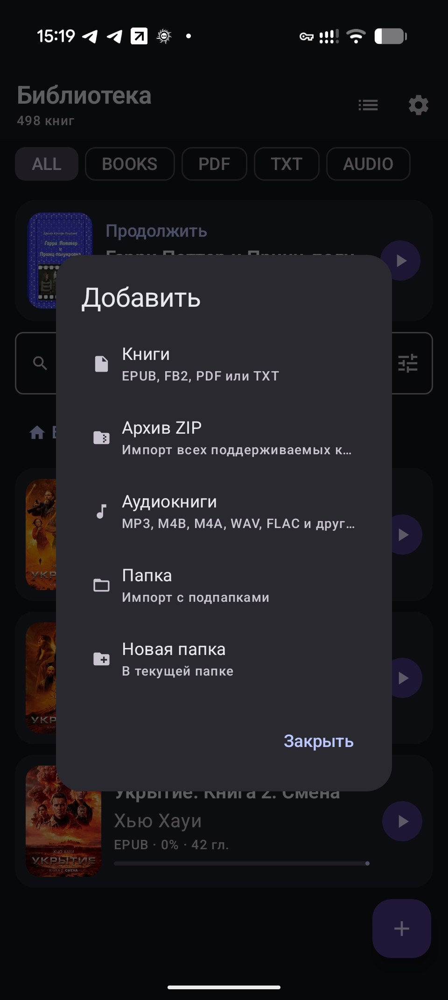</a> Импорт книг, ZIP, аудио и папок</td><td align="center" valign="top"><a href="docs/screenshots/library/selection-actions.jpg">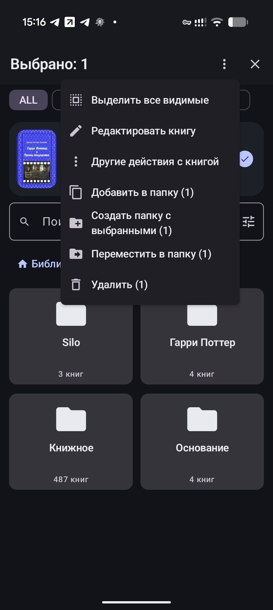</a> Меню выбранных книг и пакетные действия</td>
</tr>
</table>

<strong>Редактор метаданных и сортировка</strong>

<table>
<tr>
<td align="center" valign="top"><a href="docs/screenshots/library/book-metadata.jpg">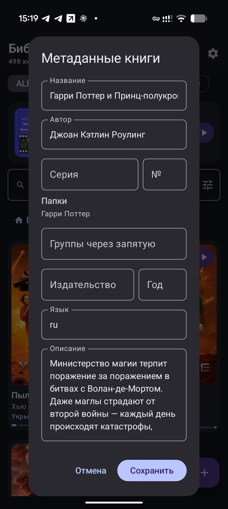</a> Редактирование метаданных книги</td><td align="center" valign="top"><a href="docs/screenshots/library/sort-and-group.jpg">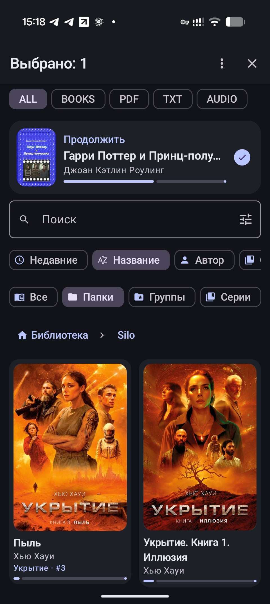</a> Сортировка и группировка библиотеки</td>
</tr>
</table>

## 03 · Обычное чтение

Выберите **прокрутку** для непрерывного текста или **страницы** для чтения экран за экраном. Панели можно скрыть, оставив текст и компактный прогресс. Обычное чтение, Speed Reader и озвучка используют единое последнее место в книге. При переключении сохраняется глава и фрагмент текста; неактивные режимы не перезаписывают позицию.

- Оглавление с переходом к нужной главе и поиск по тексту книги.
- Переходы кнопками, горизонтальными свайпами и касаниями краёв: слева — назад, справа — вперёд; центральная область управляет панелями.
- Настройка ширины зон касания и автоматического скрытия панелей.
- Процент чтения, номер главы и страницы; переход через полосу прогресса.
- Иллюстрации и структура EPUB/FB2, включая заголовки, ссылки, сноски, стихи и таблицы.
- Запуск скорочтения из читалки или с выбранного фрагмента.

<table>
<tr>
<td align="center" valign="top"><a href="docs/screenshots/reading/reader-controls.jpg">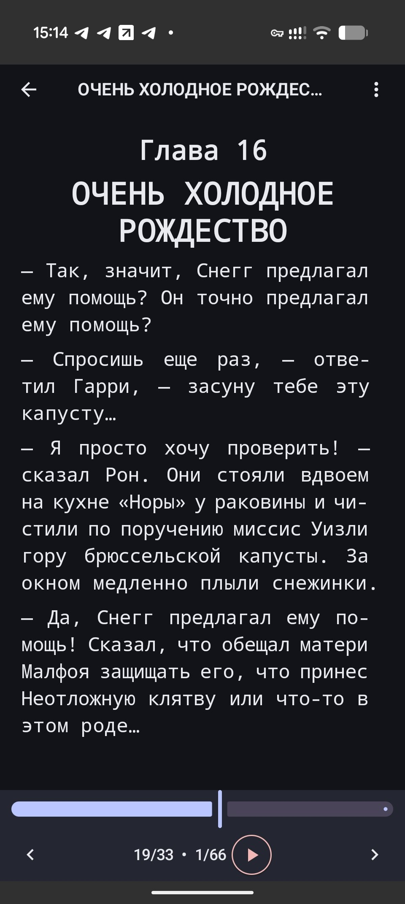</a> Чтение с навигацией и прогрессом</td><td align="center" valign="top"><a href="docs/screenshots/reading/reader-immersive.jpg">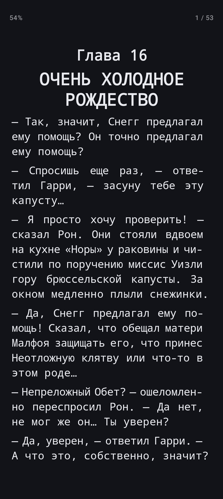</a> Чтение в полном экране</td>
</tr>
</table>

<strong>Оглавление, поиск и меню чтения</strong>

<table>
<tr>
<td align="center" valign="top"><a href="docs/screenshots/reading/reader-menu.jpg">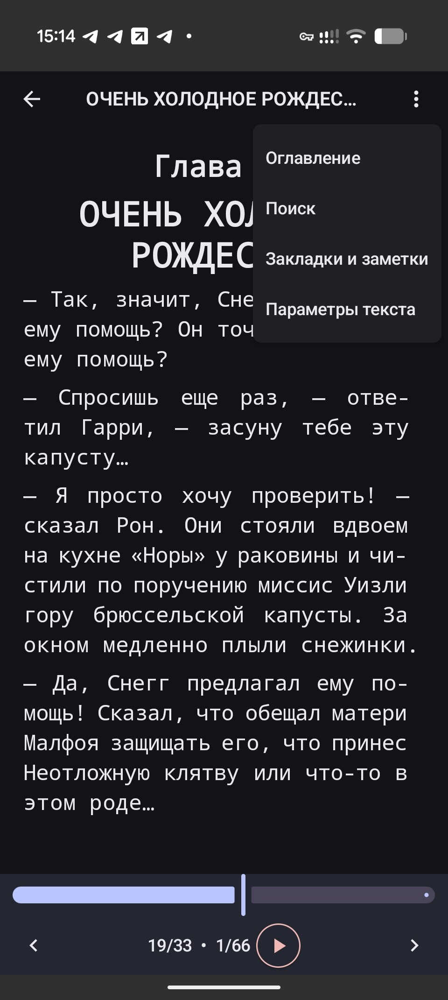</a> Меню: оглавление, поиск, заметки и параметры текста</td><td align="center" valign="top"><a href="docs/screenshots/reading/table-of-contents.jpg">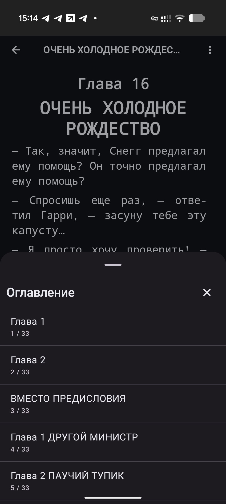</a> Оглавление и переход к главам</td><td align="center" valign="top"><a href="docs/screenshots/reading/book-search.jpg">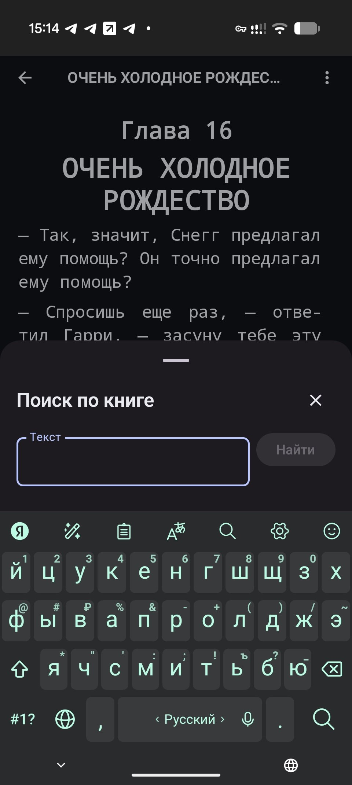</a> Поиск по тексту книги</td>
</tr>
</table>

## 04 · Текст под ваш привычный ритм

Начните с профиля **«Плотно»**, **«Книга»**, **«Крупно»** или **JetBrains**, затем настройте страницу под себя.

| Параметры | Что можно изменить |
| --- | --- |
| Шрифт | Системный, книжный, Sans, Mono, JetBrains Nerd; импорт своего TTF/OTF |
| Основной текст | Размер, межстрочный интервал, выравнивание слева или по ширине |
| Поля | Боковые, верхнее и нижнее |
| Абзацы | Интервал, красная строка, переносы слов |
| Заголовки | Центрирование, размер названия главы и номера/подзаголовка |
| Перелистывание | Лист, сдвиг, Fade, Zoom или без анимации; длительность перехода |
| Полный экран | Анимация входа и выхода, её длительность |

При выборе JetBrains Nerd без импортированного файла используется системный моноширинный шрифт. Настройки текста применяются и в обычном, и в полноэкранном режиме.

<table>
<tr>
<td align="center" valign="top"><a href="docs/screenshots/reading/fonts-and-profiles.jpg">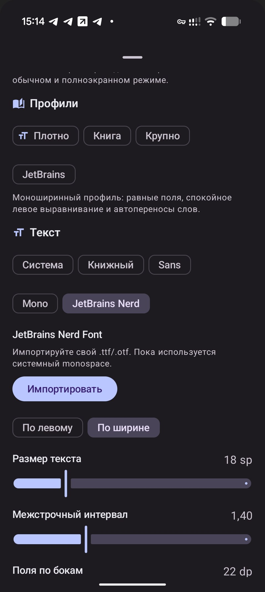</a> Профили чтения, шрифты и импорт TTF/OTF</td>
</tr>
</table>

<strong>Точное форматирование, палитры и анимации</strong>

<table>
<tr>
<td align="center" valign="top"><a href="docs/screenshots/reading/paragraphs-and-headings.jpg">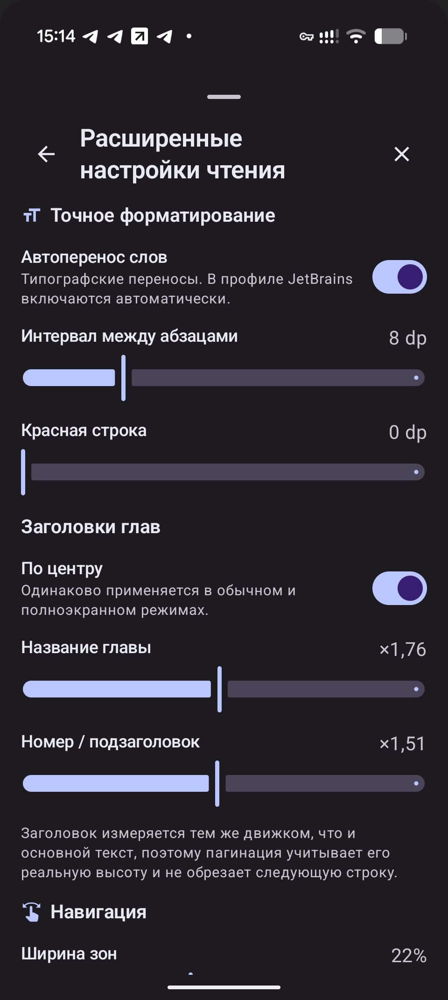</a> Переносы, абзацы и оформление заголовков</td><td align="center" valign="top"><a href="docs/screenshots/reading/tap-zones-and-animation.jpg">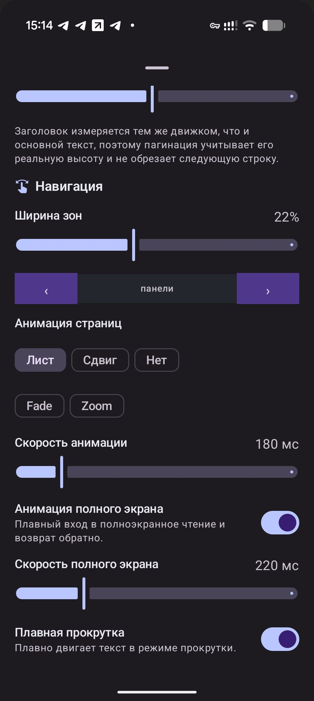</a> Зоны касания и анимации страниц</td>
</tr>
</table>
<table>
<tr>
<td align="center" valign="top"><a href="docs/screenshots/reading/margins-and-theme.jpg">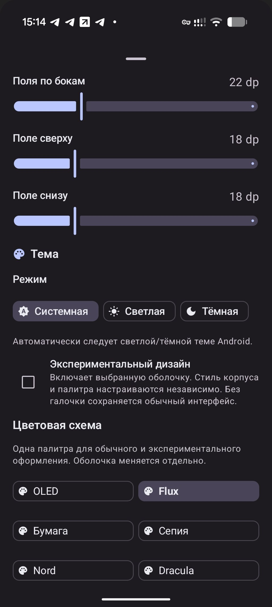</a> Поля, режим темы и цветовые схемы</td><td align="center" valign="top"><a href="docs/screenshots/reading/palettes-and-navigation.jpg">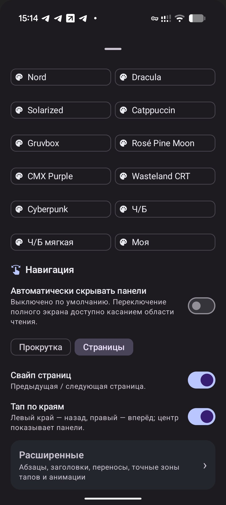</a> Палитры и способы навигации</td>
</tr>
</table>

## 05 · Закладки, выделения и заметки

Долгое нажатие на текст открывает работу с фрагментом: его можно скопировать, выделить цветом, сохранить как цитату, дополнить заметкой или начать с него скорочтение. Границы выделения можно двигать; для существующей записи доступны изменение цвета, текста заметки и удаление.

Раздел **«Заметки и выделения»** собирает записи из текущей книги или всей библиотеки. Здесь есть фильтры по типу записи, поиск по фрагментам, заметкам и книгам, сортировка по дате, книге или главе, переход к сохранённому месту и экспорт выборки в **Markdown / TXT**.

Записи хранятся отдельно от исходных книг. На скриншоте показан интерфейс раздела до добавления первой записи.

<table>
<tr>
<td align="center" valign="top"><a href="docs/screenshots/reading/annotations-workspace.jpg">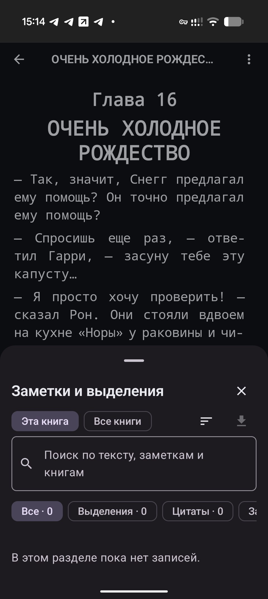</a> Заметки, выделения, цитаты и поиск по записям</td>
</tr>
</table>

## 06 · Speed Reader — чтение в заданном темпе

Текст появляется у фиксированной точки взгляда. Акцент выделяет букву или слово, а соседние слова и контекст помогают удерживать смысл. Скорость задаётся в **WPM — словах в минуту**, в диапазоне **100–3000**; это настройка темпа показа, а не обещание скорости понимания текста.

| Режим | Как показывается текст |
| --- | --- |
| **RSVP** | Последовательный показ слов у точки фиксации |
| **Фраза** | Показ группы слов за одну фиксацию |
| **Фокус** | Показ с акцентом на текущем фрагменте |

Профили темпа **«Ровно»**, **«Умно»** и **«Глубоко»** помогают выбрать характер показа. Дополнительно настраиваются число слов за фиксацию, умная разбивка и адаптивная длина фрагментов.

**Управление:** один тап — воспроизведение/пауза, двойной — полный экран, если эти жесты включены. Можно использовать кнопки на экране или кнопки громкости: короткое нажатие переключает воспроизведение, удержание переводит к соседнему предложению.

На паузе доступен окружающий текст: коснитесь нужного слова, чтобы продолжить с него. После долгой паузы можно автоматически вернуться к началу предложения. Переход между обычным чтением и скорочтением сохраняет связь с местом в книге.

<table>
<tr>
<td align="center" valign="top"><a href="docs/screenshots/speed-reading/word-and-context.jpg">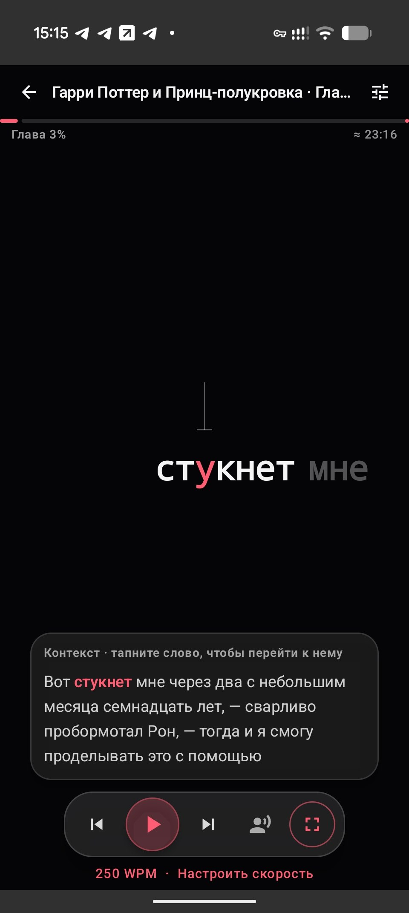</a> Точка фиксации и контекст на паузе</td><td align="center" valign="top"><a href="docs/screenshots/speed-reading/immersive-context.jpg">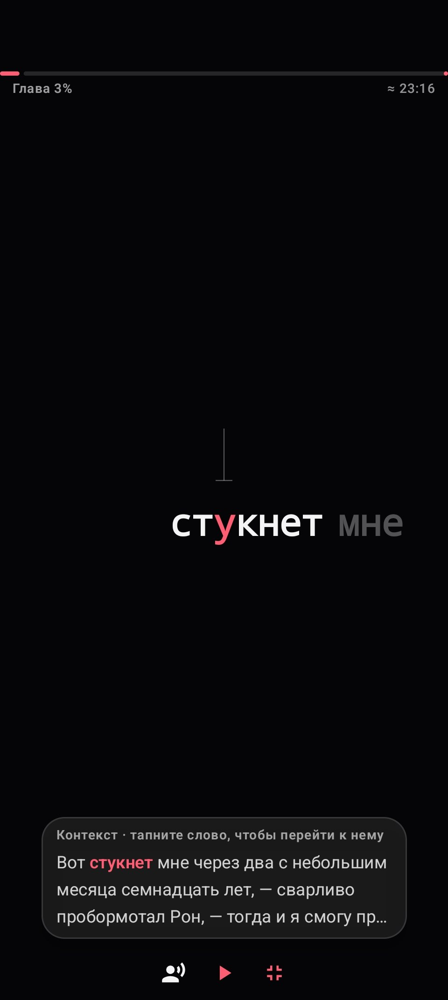</a> Полный экран с контекстом и компактным управлением</td>
</tr>
</table>

<strong>Все группы настроек скорочтения</strong>

| Группа | Возможности |
| --- | --- |
| **Отображение** | Шрифт и его импорт, тема читалки, ORP-направляющая, периферийные слова, сегмент/контекст под словом, прогресс главы/книги |
| **Поведение** | Тапы и кнопки громкости, контекст на паузе, умный возврат, время показа иллюстрации и заставки новой главы |
| **Тайминги** | Микропаузы после предложения, запятой и других разделителей, пауза между абзацами, замедление длинных слов |
| **Разгон** | Постепенный выход на выбранный темп после старта, иллюстрации или новой главы; начальная скорость и длительность разгона |
| **Геометрия** | Фиксированный размер или автоподгонка текста, горизонтальная и вертикальная точка фиксации, ширина области, насыщенность и межбуквенный интервал |
| **Фокус** | Акцент на ORP-букве или целом слове, число следующих слов, направляющая и поперечные метки |
| **Цвета** | Независимые цвета текста, фокуса, фона и направляющей |

<table>
<tr>
<td align="center" valign="top"><a href="docs/screenshots/speed-reading/settings-hub.jpg">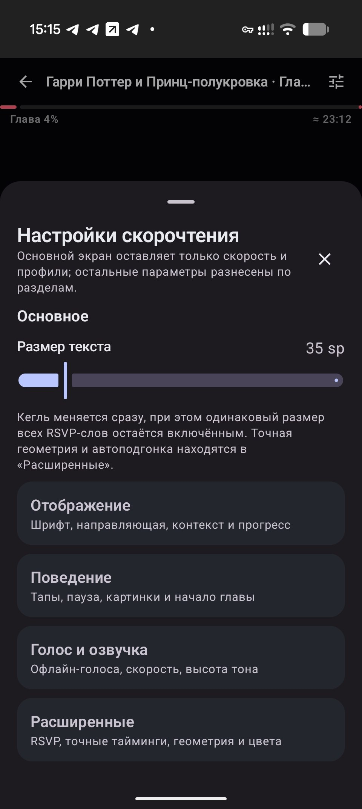</a> Разделы настройки скорочтения</td><td align="center" valign="top"><a href="docs/screenshots/speed-reading/speed-and-pacing.jpg">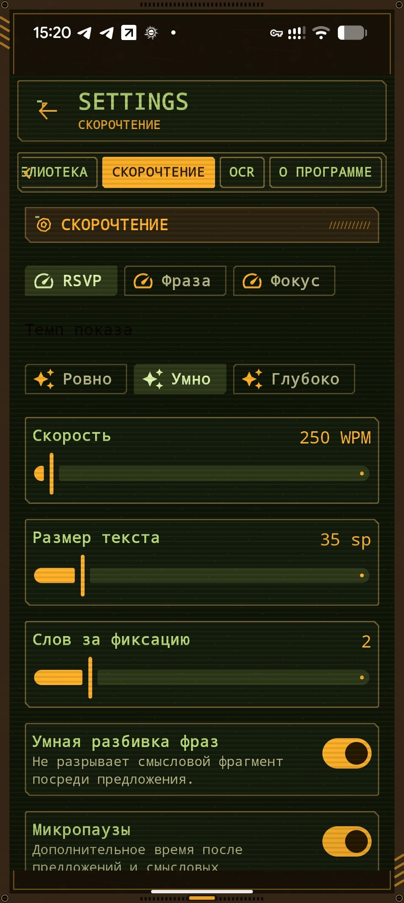</a> Режимы, профили темпа, WPM и слов за фиксацию</td>
</tr>
</table>
<table>
<tr>
<td align="center" valign="top"><a href="docs/screenshots/speed-reading/display-preferences.jpg">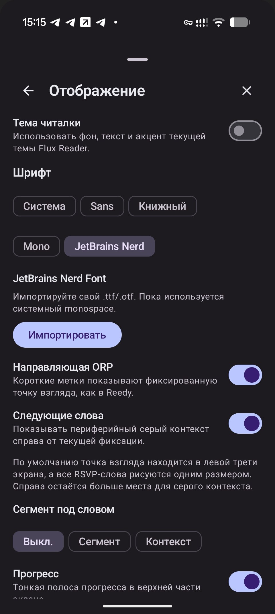</a> Шрифт, ORP, следующие слова и прогресс</td><td align="center" valign="top"><a href="docs/screenshots/speed-reading/behavior-preferences.jpg">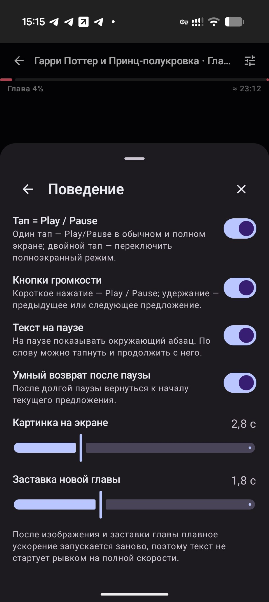</a> Касания, кнопки громкости и поведение после паузы</td>
</tr>
</table>
<table>
<tr>
<td align="center" valign="top"><a href="docs/screenshots/speed-reading/rsvp-and-timing.jpg">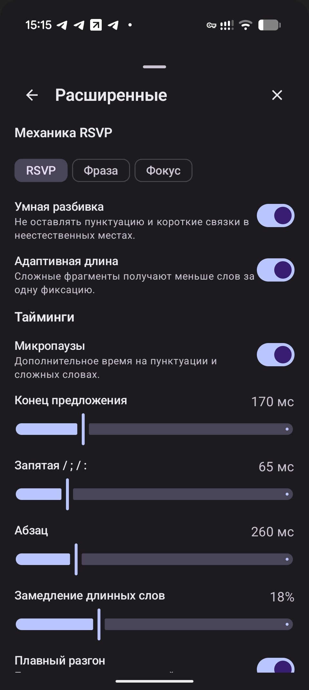</a> Механика RSVP и точные паузы</td><td align="center" valign="top"><a href="docs/screenshots/speed-reading/acceleration-and-geometry.jpg">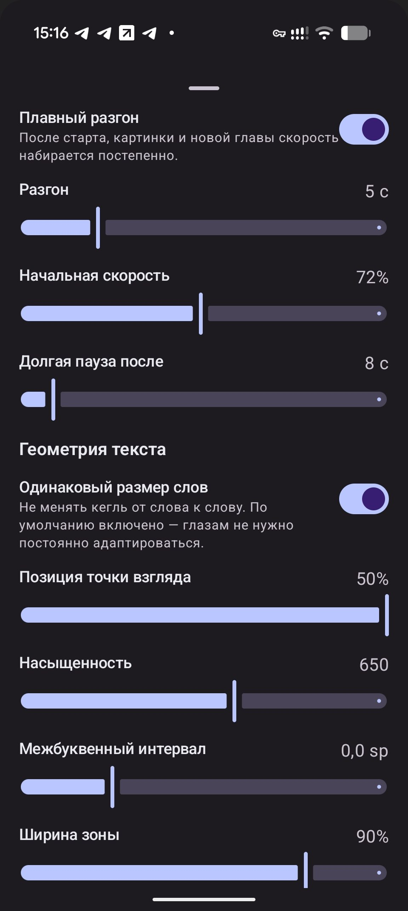</a> Плавный разгон и геометрия текста</td>
</tr>
</table>
<table>
<tr>
<td align="center" valign="top"><a href="docs/screenshots/speed-reading/guide-and-focus.jpg">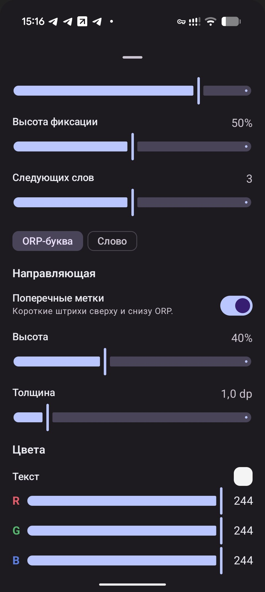</a> Фиксация, направляющая и стиль подсветки</td><td align="center" valign="top"><a href="docs/screenshots/speed-reading/custom-colors.jpg">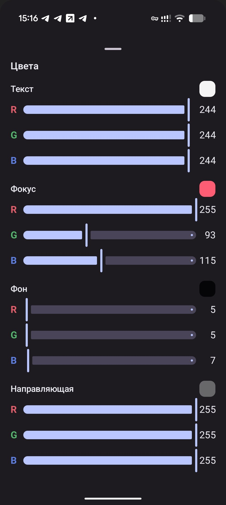</a> Цвета текста, фокуса, фона и направляющей</td>
</tr>
</table>

## 07 · Голос и аудиокниги

### Озвучка текста

В Speed Reader можно включить голос и слушать книгу установленным **офлайн-голосом Android TTS**. Доступны выбор голоса или автовыбор, скорость речи, высота тона и переход к следующей главе.

Показ слов при озвучке связан с текущей позицией речи. Доступность языков и качество голоса зависят от установленного движка TTS и его локальных голосов. Отдельная нейросетевая голосовая модель в приложение не встроена.

<table>
<tr>
<td align="center" valign="top"><a href="docs/screenshots/voice/offline-tts.jpg">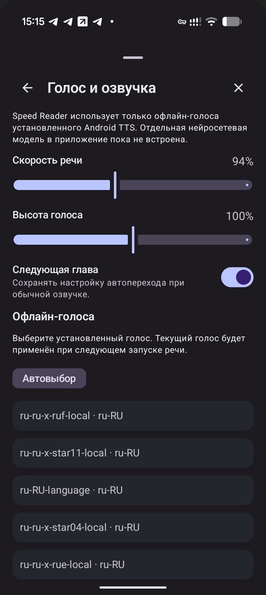</a> Офлайн-голоса Android TTS, скорость и высота речи</td>
</tr>
</table>

### Готовые аудиофайлы

Аудиокниги добавляются через **«+» → «Аудиокниги»** и доступны через фильтр **AUDIO**. Плеер поддерживает воспроизведение и паузу, перемотку по шкале, переход на 15 секунд назад/вперёд и сохранение позиции. При удалении записи из аудиобиблиотеки исходный файл на устройстве остаётся.

В присланной подборке есть меню импорта аудио и фильтр AUDIO; отдельного кадра аудиоплеера нет.

## 08 · Спокойный интерфейс или атмосферная оболочка

Обычный интерфейс можно оставить лаконичным или включить экспериментальную оболочку **Wasteland / Cyberpunk**. Оболочка и палитра выбираются отдельно: оформление меняется, а книги и позиции чтения сохраняются.

**Палитры:** OLED, Flux, Бумага, Сепия, Nord, Dracula, Solarized, Catppuccin, Gruvbox, Rosé Pine Moon, CMX Purple, Wasteland CRT, Cyberpunk, Ч/Б, Ч/Б мягкая и пользовательская **«Моя»**. Режим темы — системный, светлый или тёмный.

Для экспериментальных оболочек доступны **CRT-эффекты**: линии развёртки, свечение люминофора, статичный шум и затемнение краёв. Каждый эффект можно переключить отдельно; общая интенсивность регулируется ползунком. Есть и главный выключатель всех эффектов.

<table>
<tr>
<td align="center" valign="top"><a href="docs/screenshots/appearance/cyberpunk-shell.jpg">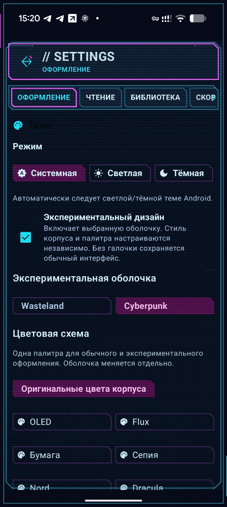</a> Оболочка Cyberpunk и выбор палитры</td><td align="center" valign="top"><a href="docs/screenshots/appearance/crt-effects.jpg">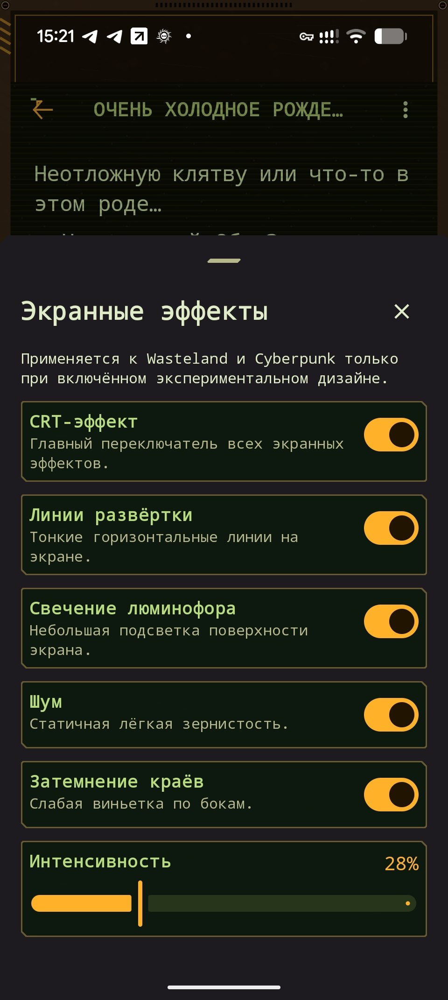</a> Линии развёртки, свечение, шум и затемнение краёв</td>
</tr>
</table>

<strong>Как Wasteland выглядит в библиотеке и Speed Reader</strong>

<table>
<tr>
<td align="center" valign="top"><a href="docs/screenshots/library/wasteland-list.jpg">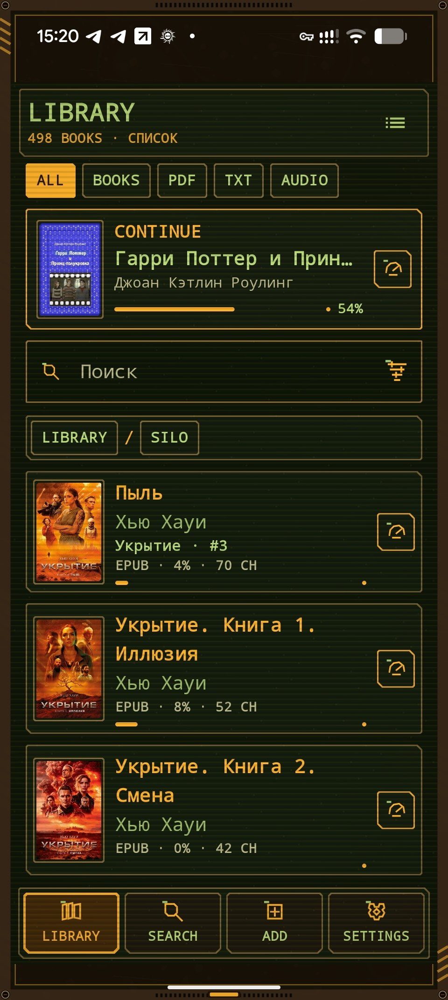</a> Wasteland: библиотека списком</td><td align="center" valign="top"><a href="docs/screenshots/library/wasteland-grid.jpg">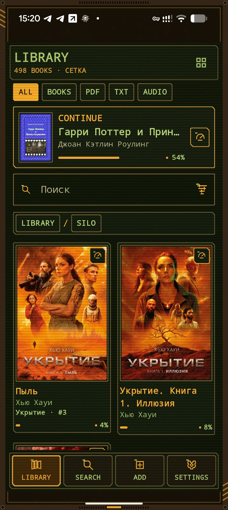</a> Wasteland: крупные обложки</td><td align="center" valign="top"><a href="docs/screenshots/library/wasteland-compact.jpg">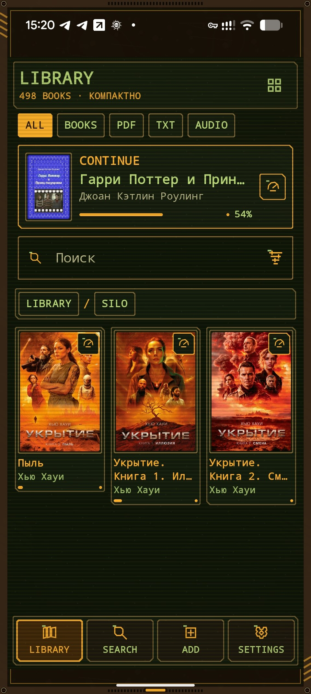</a> Wasteland: компактная сетка</td>
</tr>
</table>
<table>
<tr>
<td align="center" valign="top"><a href="docs/screenshots/speed-reading/wasteland-chapter-intro.jpg">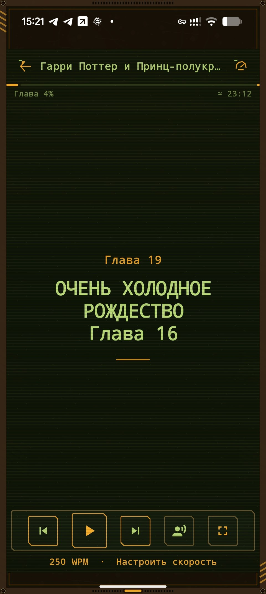</a> Wasteland: заставка главы и управление</td><td align="center" valign="top"><a href="docs/screenshots/speed-reading/wasteland-context.jpg">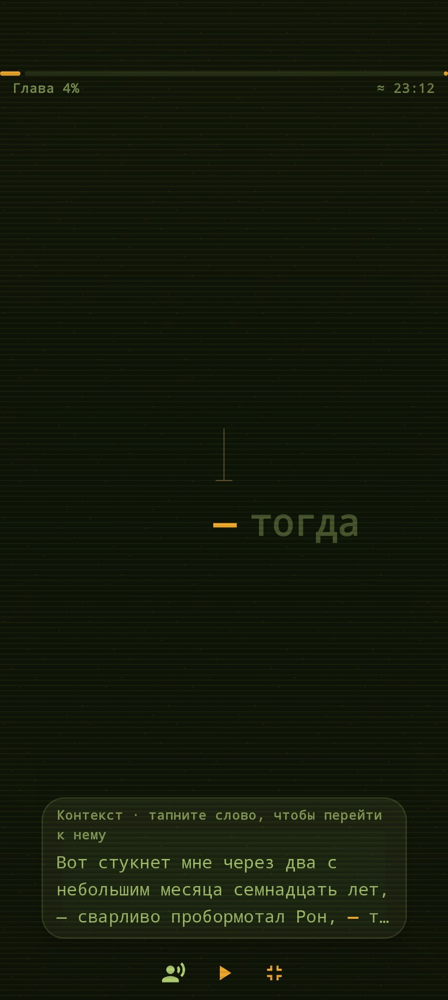</a> Wasteland: контекст в полном экране</td><td align="center" valign="top"><a href="docs/screenshots/speed-reading/wasteland-playback.jpg">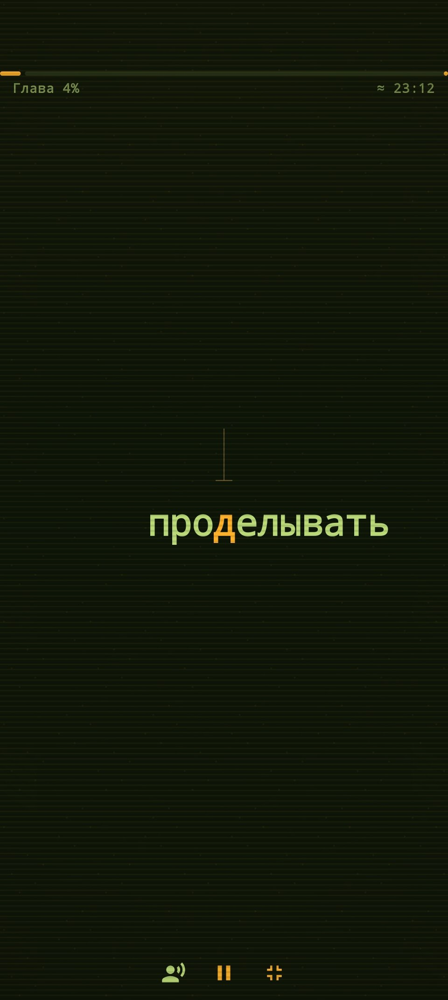</a> Wasteland: RSVP во время воспроизведения</td>
</tr>
</table>

## 09 · PDF и распознавание сканов

PDF открывается как документ со страницами, масштабированием и сохранением позиции. Если в нём есть текстовый слой, его можно использовать для поиска и скорочтения. Для сканированных страниц предусмотрено локальное OCR — распознавание текста на устройстве.

- **Tesseract:** русский, украинский и английский при наличии соответствующих языковых моделей в сборке.
- **ML Kit Latin:** резервное распознавание латинского текста без дополнительных моделей Tesseract.
- OCR запускается для страниц без встроенного текста и управляется отдельным переключателем.

**В опубликованной alpha.95 языковые модели Tesseract не вложены.** Поэтому наличие переключателей rus/ukr/eng не означает, что все три языка готовы к распознаванию. Для полноценного OCR этих языков нужна сборка с моделями. На скриншоте показаны настройки OCR; отдельного кадра открытого PDF нет.

<table>
<tr>
<td align="center" valign="top"><a href="docs/screenshots/pdf-ocr/ocr-preferences.jpg">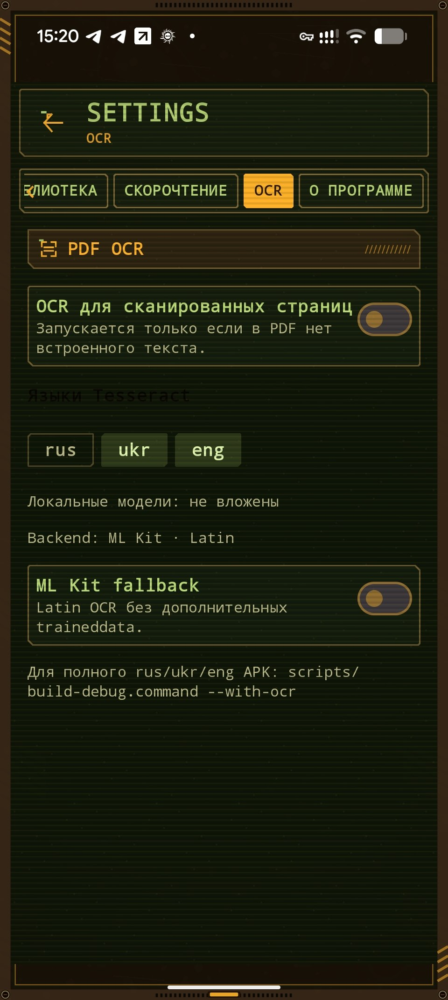</a> PDF OCR: языки Tesseract и ML Kit Latin</td>
</tr>
</table>

## 10 · Установка и обновления

1. Откройте [релиз 0.2.0-alpha.95](https://github.com/nrevis/FluxReader/releases/tag/v0.2.0-alpha.95).
2. Скачайте **FluxReader-0.2.0-alpha.95-release.apk** и откройте его на Android 9 или новее.
3. Разрешите установку для приложения, из которого открываете APK, и подтвердите действие в системном установщике.

APK alpha.95 сохраняет сертификат предыдущих локальных alpha-сборок и подходит для обновления поверх alpha.92/alpha.93/alpha.94.

В **«Настройки → О программе → Обновления»** добавлены ручная проверка GitHub Releases, необязательная проверка раз в сутки, выбор alpha-канала, скачивание APK с прогрессом и переход к системной установке. Перед установкой проверяются контрольная сумма SHA-256, имя пакета, номер версии и сертификат.

> **Тестовые версии:** текущие выпуски помечены как alpha. Чтобы получать их, включите «Включая тестовые alpha-релизы» и нажмите «Проверить». Репозиторий публичный, вход в GitHub для обновлений не требуется. Скриншот раздела обновлений в подборке отсутствует.

Для самостоятельной сборки см. [инструкцию разработчика](DEVELOPMENT.md). Подробности формата обновлений — в [RELEASE-UPDATES.md](RELEASE-UPDATES.md).

---

## Галерея по функциям

В обзор отобраны ключевые кадры. Ниже сохранены **все 52 скриншота**, включая альтернативные виды и настройки; каждый можно открыть в полном размере. Номера исходных фото и расположение файлов приведены в [индексе скриншотов](docs/SCREENSHOTS.md).

<strong>Библиотека, импорт и организация · 15 кадров</strong>

<table>
<tr>
<td align="center" valign="top"> Папки библиотеки: компактная сетка</td><td align="center" valign="top"> Папки библиотеки: список</td><td align="center" valign="top"> Папки библиотеки: крупная сетка</td>
</tr>
</table>
<table>
<tr>
<td align="center" valign="top"> Меню выбранных книг и пакетные действия</td><td align="center" valign="top"><a href="docs/screenshots/library/books-selection.jpg">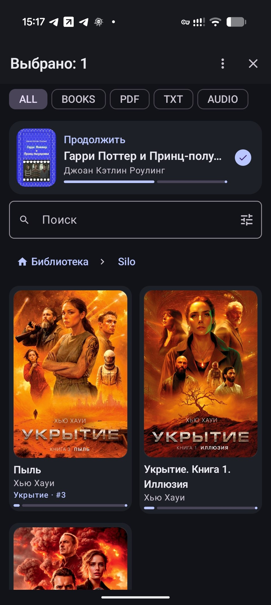</a> Обложки книг внутри папки и режим выбора</td><td align="center" valign="top"> Сортировка и группировка библиотеки</td>
</tr>
</table>
<table>
<tr>
<td align="center" valign="top"> Редактирование метаданных книги</td><td align="center" valign="top"> Книги: компактная сетка</td><td align="center" valign="top"> Книги: список с автором, серией и прогрессом</td>
</tr>
</table>
<table>
<tr>
<td align="center" valign="top"> Импорт книг, ZIP, аудио и папок</td><td align="center" valign="top"> Wasteland: библиотека списком</td><td align="center" valign="top"><a href="docs/screenshots/library/wasteland-import.jpg">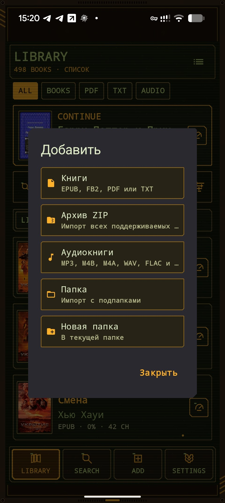</a> Wasteland: меню импорта</td>
</tr>
</table>
<table>
<tr>
<td align="center" valign="top"> Настройки вида, группировки и обложек</td><td align="center" valign="top"> Wasteland: крупные обложки</td><td align="center" valign="top"> Wasteland: компактная сетка</td>
</tr>
</table>

<strong>Чтение, навигация, текст и заметки · 16 кадров</strong>

<table>
<tr>
<td align="center" valign="top"> Чтение с навигацией и прогрессом</td><td align="center" valign="top"> Чтение в полном экране</td><td align="center" valign="top"> Меню: оглавление, поиск, заметки и параметры текста</td>
</tr>
</table>
<table>
<tr>
<td align="center" valign="top"> Оглавление и переход к главам</td><td align="center" valign="top"> Поиск по тексту книги</td><td align="center" valign="top"> Заметки, выделения, цитаты и поиск по записям</td>
</tr>
</table>
<table>
<tr>
<td align="center" valign="top"> Профили чтения, шрифты и импорт TTF/OTF</td><td align="center" valign="top"> Поля, режим темы и цветовые схемы</td><td align="center" valign="top"> Палитры и способы навигации</td>
</tr>
</table>
<table>
<tr>
<td align="center" valign="top"> Зоны касания и анимации страниц</td><td align="center" valign="top"> Переносы, абзацы и оформление заголовков</td><td align="center" valign="top"><a href="docs/screenshots/reading/reader-next-page.jpg">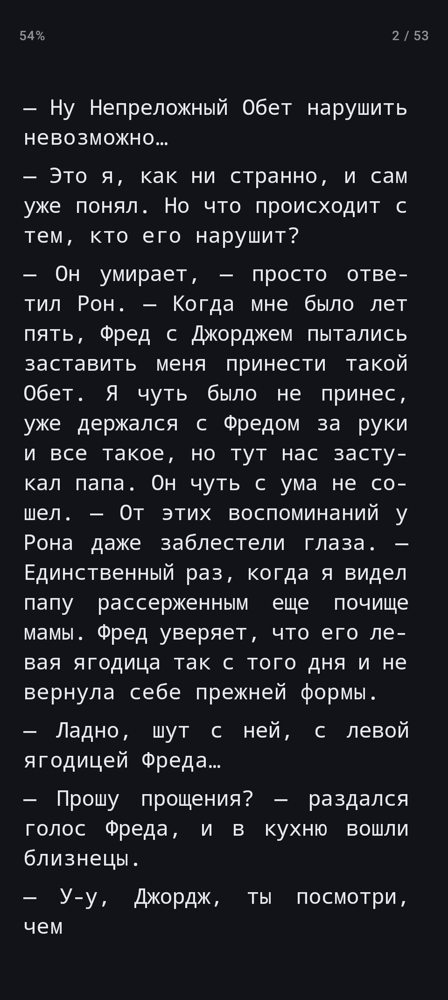</a> Следующая страница в полном экране</td>
</tr>
</table>
<table>
<tr>
<td align="center" valign="top"><a href="docs/screenshots/reading/wasteland-reader-menu.jpg">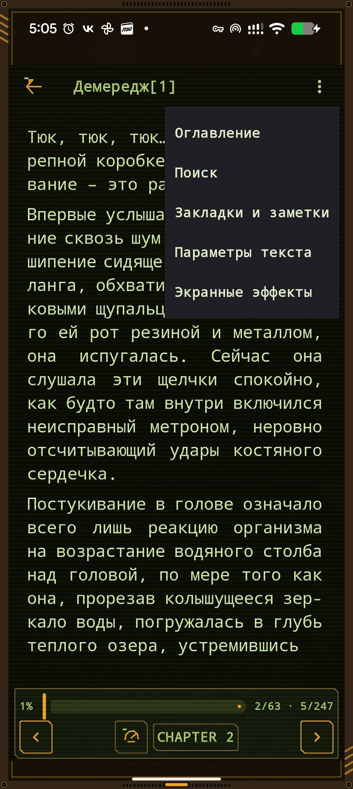</a> Wasteland: меню чтения и экранных эффектов</td><td align="center" valign="top"><a href="docs/screenshots/reading/wasteland-immersive-alt.jpg">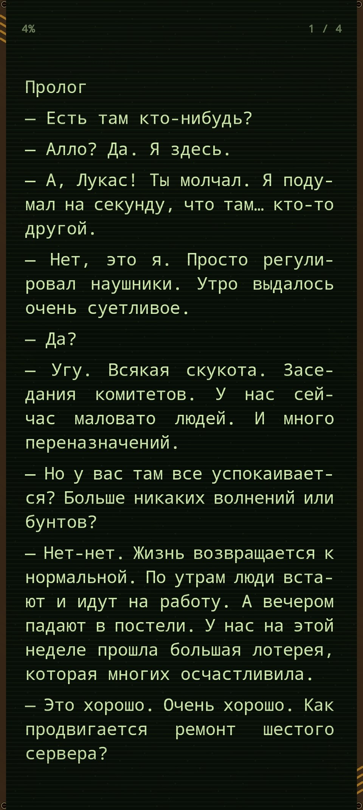</a> Wasteland: полноэкранная страница другой книги</td><td align="center" valign="top"><a href="docs/screenshots/reading/wasteland-navigation.jpg">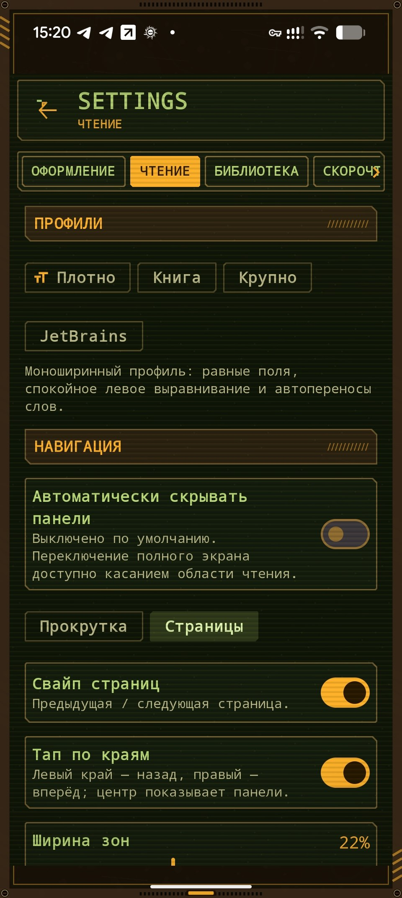</a> Wasteland: профили и настройки навигации</td>
</tr>
</table>
<table>
<tr>
<td align="center" valign="top"> Wasteland: полноэкранное чтение</td>
</tr>
</table>

<strong>Скорочтение и его настройки · 17 кадров</strong>

<table>
<tr>
<td align="center" valign="top"><a href="docs/screenshots/speed-reading/chapter-intro.jpg">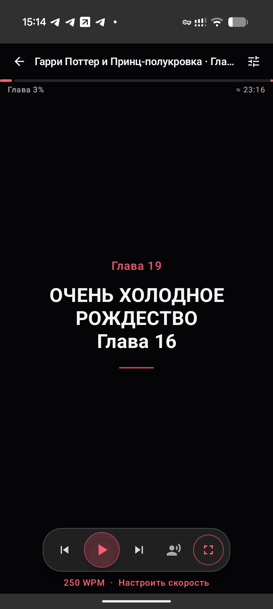</a> Заставка новой главы в Speed Reader</td><td align="center" valign="top"> Точка фиксации и контекст на паузе</td><td align="center" valign="top"> Полный экран с контекстом и компактным управлением</td>
</tr>
</table>
<table>
<tr>
<td align="center" valign="top"> Полноэкранное скорочтение во время воспроизведения</td><td align="center" valign="top"> Разделы настройки скорочтения</td><td align="center" valign="top"> Шрифт, ORP, следующие слова и прогресс</td>
</tr>
</table>
<table>
<tr>
<td align="center" valign="top"> Касания, кнопки громкости и поведение после паузы</td><td align="center" valign="top"> Механика RSVP и точные паузы</td><td align="center" valign="top"> Плавный разгон и геометрия текста</td>
</tr>
</table>
<table>
<tr>
<td align="center" valign="top"> Фиксация, направляющая и стиль подсветки</td><td align="center" valign="top"> Цвета текста, фокуса, фона и направляющей</td><td align="center" valign="top"> Wasteland: скорочтение пролога</td>
</tr>
</table>
<table>
<tr>
<td align="center" valign="top"> Режимы, профили темпа, WPM и слов за фиксацию</td><td align="center" valign="top"> Wasteland: заставка главы и управление</td><td align="center" valign="top"> Wasteland: контекст в полном экране</td>
</tr>
</table>
<table>
<tr>
<td align="center" valign="top"> Wasteland: RSVP во время воспроизведения</td><td align="center" valign="top"> Wasteland: настройки Speed Reader</td>
</tr>
</table>

<strong>Голос и озвучка · 1 кадр</strong>

<table>
<tr>
<td align="center" valign="top"> Офлайн-голоса Android TTS, скорость и высота речи</td>
</tr>
</table>

<strong>Оформление и экранные эффекты · 2 кадра</strong>

<table>
<tr>
<td align="center" valign="top"> Оболочка Cyberpunk и выбор палитры</td><td align="center" valign="top"> Линии развёртки, свечение, шум и затемнение краёв</td>
</tr>
</table>

<strong>PDF и OCR · 1 кадр</strong>

<table>
<tr>
<td align="center" valign="top"> PDF OCR: языки Tesseract и ML Kit Latin</td>
</tr>
</table>

---

**Flux Reader · n.revis**

[Релизы](https://github.com/nrevis/FluxReader/releases) · [Исходники](https://github.com/nrevis/FluxReader)

Описание сверено с исходниками 0.2.0-alpha.95. Скриншоты предоставлены автором; выбранные на них значения и содержимое библиотеки служат примерами.

